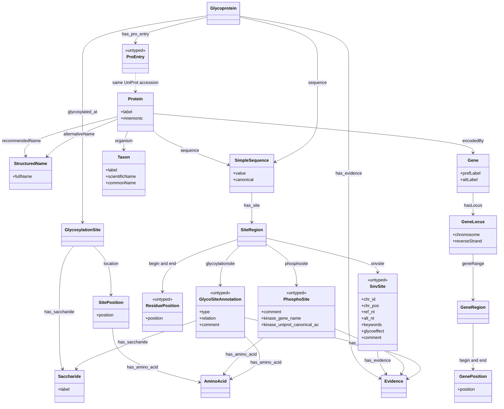

# GlyGen Knowledge Graph Chat Transcript

👤 **User**  
@glygenkg: Give a high-level overview of this knowledge graph, including its main entities, relationships, and purpose.

---

🧠 **Assistant**  
Here's a high-level overview of the **GlyGen Knowledge Graph** (`glygenkg`), release v0.0.1.

**What it is.** GlyGen KG is the RDF knowledge graph built from [GlyGen](https://www.glygen.org/), a data integration and dissemination project for carbohydrate and glycoconjugate data. This release covers **protein glycosylation in human**: which proteins are glycosylated, at which residues, with which glycans, and according to which publications. It holds about 1.1 million triples, 15 classes and 46 predicates, and reuses the UniProt core, GlycoRDF and FALDO vocabularies alongside GlyGen's own ontology.

## Main entities

| Entity | Count | What it is |
|---|---|---|
| **Protein** | 8,112 | Human UniProtKB proteins with glycosylation data, with recommended name, mnemonic and alternative names |
| **Gene** | 8,097 | The encoding gene, with symbol and synonyms |
| **Gene Locus** | 7,959 | The Ensembl gene, with chromosome, strand and begin/end coordinates |
| **Glycoprotein** | 74,722 | A glycosylation *record*: one reported observation for a protein isoform, with one publication and at most one site |
| **Glycosylation Site** | 67,510 | The glycosylated residue of a record, covering 22,392 distinct protein positions |
| **Saccharide** | 1,248 | A glycan, identified by its GlyTouCan accession and labelled with composition and type, e.g. "Hex5HexNAc4 (N-linked, Biantennary)" |
| **Evidence** | 1,516 | A PubMed publication supporting a record |
| **Amino Acid** | 10 | The residue type at a modified position (Asn, Ser, Thr, ...) |
| **Simple Sequence** | 8,111 | An isoform amino acid sequence |
| **Site annotations** | 7,874 | Protein residues annotated with a variant (7,482), a phosphorylation site (302) or a glycosylation annotation (102) |

## Key relationships

- **Protein layer:** `Protein → encodedBy → Gene → hasLocus → Gene Locus → geneRange → Region → begin/end → position`, plus `Protein → recommendedName / alternativeName → Structured Name` and `Protein → organism → Taxon` (always human).
- **Glycosylation layer:** `Glycoprotein → glycosylated_at → Glycosylation Site → has_saccharide → Saccharide`, with `Glycosylation Site → location → Exact Position → position` and `→ has_amino_acid → Amino Acid`. Every record also has `has_evidence → Evidence` and `has_pro_entry →` a Protein Ontology entry.
- **Site annotation layer:** `isoform → has_site → Region → snvsite / phosphosite / glycoylationsite →` an annotation node carrying the variant's chromosome position, alleles, category (germline, somatic, cancer, disease) and predicted effect on glycosylation, or the phosphorylation site's kinase.

## What it can answer

- Which residues of a protein are glycosylated, and which glycans are attached at each site?
- Which glycans are found on the most proteins, and which publications report them?
- Which variants in a gene are predicted to create or remove a glycosylation site?

For example, the glycans found on the most proteins are:

| Glycan | Label | Proteins |
|---|---|---|
| G49108TO | HexNAc1 (O-linked, O-GlcNAc) | 3,540 |
| G62765YT | Hex8HexNAc2 (N-linked, High mannose) | 519 |
| G80920RR | Hex9HexNAc2 (N-linked, High mannose) | 475 |
| G57321FI | HexNAc1 (Other, Other) | 450 |
| G43417UB | Hex1HexNAc1 (O-linked, Core 1) | 435 |

And the 3,969 variants with a predicted glycosylation effect break down as 2,525 N-glycosylation sequon gains, 1,424 O-glycosylation site losses and 20 N-glycosylation sequon losses.

## Things to know before querying

- **A `Glycoprotein` node is a record, not a protein.** To count glycoproteins, count distinct `has_pro_entry` values (8,112), not `Glycoprotein` nodes.
- **Records do not link directly to proteins.** Rewrite the Protein Ontology IRI `http://purl.obolibrary.org/obo/PR_<accession>` to `http://purl.uniprot.org/uniprot/<accession>` to reach the protein, its names and its gene.
- **The stored sequence is often not the canonical isoform.** Each protein has one sequence, flagged canonical for only 1,170 of them.
- **Two FALDO namespaces are in use:** the standard `http://biohackathon.org/resource/faldo#` for gene coordinates and `http://www.biohackathon.org/resource/faldo#` for protein sites.
- **Variant, phosphorylation and site-annotation nodes carry no `rdf:type`;** reach them through `snvsite`, `phosphosite` and `glycoylationsite` (the last is spelled that way in the data).
- **Glycan details are limited to the label.** There is no structure encoding or mass; filter on the label text to separate N-linked from O-linked glycans.

---

👤 **User**  
Visualize the schema

---

🧠 **Assistant**  

**Reading the diagram.** The graph has three connected layers.

- **Protein layer (top):** a `Protein` has structured names, an encoding `Gene`, an organism and one sequence. The gene leads to its Ensembl `GeneLocus` and, through a FALDO region, to its chromosome coordinates. `GeneRegion` and `GenePosition` are `faldo:Region` and `faldo:ExactPosition` in the standard FALDO namespace.
- **Glycosylation layer (middle):** each `Glycoprotein` record points to one `GlycosylationSite`, one `Evidence` publication and a Protein Ontology entry. The site gives the attached `Saccharide` and, through `SitePosition`, the residue number and `AminoAcid`. The dashed edge is not a triple: the Protein Ontology IRI and the protein IRI share the UniProt accession, and that is how a record is joined to its protein.
- **Site annotation layer (bottom):** an isoform's `SiteRegion` marks a residue range and links to a variant, a phosphorylation site or a glycosylation annotation. `SiteRegion` and `SitePosition` are `faldo:Region` and `faldo:ExactPosition` in the `www.biohackathon.org` namespace.

Classes marked `untyped` are node families that carry no `rdf:type` in the data; they are named here by their IRI pattern (for example `http://glygen.org/snvsite/SNVSITE_...`).

---

*Created by [mcp-proto-okn](https://github.com/sbl-sdsc/mcp-proto-okn) 0.6.1 on 2026-10-13*

*Model: claude-opus-5-5*

*Counts and examples were queried directly from the FRINK federation endpoint (`https://apps.okn.us/federation/sparql`), graph `https://purl.org/okn/frink/kg/glygenkg`.*
